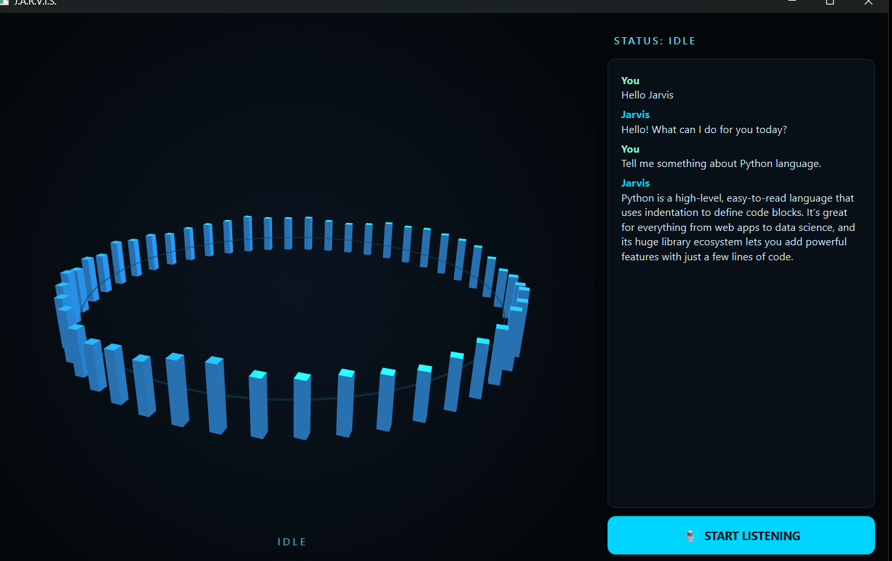

# JARVIS: Voice-Controlled AI Desktop Assistant

A Windows desktop voice assistant that listens, thinks, and talks back. It answers questions with an LLM, controls your PC with a safe set of commands, remembers things you tell it, and shows a live 3D waveform that reacts to its state. It understands both **English and Hindi**.



## Features

- **Voice input**: speech-to-text with Whisper (via Groq), with silence and false-transcription filtering
- **Voice output**: natural neural voices with `edge-tts` (English and Hindi), press `Esc` to interrupt
- **AI brain**: LLM answers through the Groq API, with recent conversation context
- **PC control**: battery, CPU/RAM stats, time, screenshots, open apps
- **Web commands**: "open GitHub and search ...", "search ... on Flipkart", "play ... on YouTube" (autoplays the top result)
- **Memory**: "remember that ...", "what do you remember", "forget ..." (stored locally in SQLite)
- **Bilingual**: speak Hindi or English, and Jarvis replies in the same language
- **3D GUI**: PySide6 window with an embedded Three.js waveform that changes with listening, thinking, and speaking

## Tech stack

Python 3.13, PySide6 (Qt WebEngine), Three.js, Groq API (Whisper + LLM), edge-tts, SpeechRecognition + PyAudio, SQLite, pygame, psutil, pyautogui

## Project structure

```
jarvis/
├── gui_main.py          # GUI entry point + command routing
├── function.py          # PC-control and web functions (whitelist)
├── voice_input.py       # mic capture + Whisper transcription
├── voice_output.py      # text-to-speech
├── ai_brain.py          # LLM calls with memory context
├── memory.py            # SQLite memory
├── hindi_commands.py    # Hindi command words -> English keywords
├── gui/                 # waveform.html, css/, js/, style.qss
├── requirements.txt
└── .env.example
```

## Setup (Windows)

1. **Install Python 3.13** (newer versions may lack prebuilt PyAudio wheels).

2. **Clone and create a virtual environment**
   ```
   git clone https://github.com/msi15thin/Jarvis-Voice-Assistant jarvis
    cd jarvis
    py -3.13 -m venv venv
   .\venv\Scripts\Activate.ps1
    pip install -r requirements.txt

3. **Add your API key**: copy `.env.example` to `.env` and put in a free key from [console.groq.com](https://console.groq.com):
   ```
   GROQ_API_KEY=your_key_here
   ```

4. **Download Three.js** into the GUI folder:
   ```
   Invoke-WebRequest -Uri "https://cdnjs.cloudflare.com/ajax/libs/three.js/r128/three.min.js" -OutFile "gui\js\three.min.js"
   ```

5. **Pick your microphone.** Device numbers differ per PC. List them:
   ```python
   import speech_recognition as sr
   for i, n in enumerate(sr.Microphone.list_microphone_names()):
       print(i, n)
   ```
   Record a few seconds from candidates, find the one that sounds clear, and set `MIC_INDEX` at the top of `voice_input.py`.

6. **Run**
   ```
   python gui_main.py
   ```
   Click **Start Listening** and talk.

## Example commands

| Say | What happens |
|---|---|
| "What's my battery?" | Reads battery status |
| "Open GitHub and search jarvis" | Opens GitHub search results |
| "Play Believer on YouTube" | Opens and plays the top result |
| "Take a screenshot" | Saves a screenshot to your Pictures folder |
| "Remember that my name is ..." | Saves it to memory |
| "यूट्यूब खोलो" | Hindi commands work too |
| "Goodbye" | Exits the voice loop |

## Design notes

- **Whitelisted actions only.** The AI never runs raw shell commands. Every PC action is a named Python function, so a wrong guess can't delete files or run arbitrary code.
- **Transcription hardening.** Silent or noisy recordings are dropped before reaching Whisper, and common Whisper hallucinations ("Thank you.") are filtered out.
- **Local memory.** Facts and chat history live in `jarvis_memory.db` on your machine, but they are sent to the LLM as context, so don't store passwords or private data.

## Limitations

- Windows only (uses Windows paths, `keyboard`, and `pyautogui`).
- Needs an internet connection (speech recognition, LLM, and voices are online services).
- Mixed Hindi-English (Hinglish) sentences can be transcribed inaccurately.
- Names and brand words may be misheard by speech recognition.
- YouTube autoplay depends on YouTube's page layout and may fall back to the search page.

## Roadmap

- Wake word ("Hey Jarvis")
- Volume and media controls
- Confirmation-gated system commands (lock, shutdown)